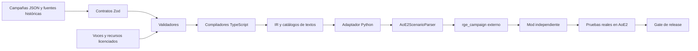

# Arquitectura

## Responsabilidades

| Directorio | Propiedad |
|---|---|
| packages/core | `diagnostics.helper.ts`, `serialization.helper.ts`, `filesystem.helper.ts` |
| packages/schemas | `campaign.schema.ts`: contratos estrictos versionados |
| packages/localization | `localization.catalog.ts`, `glossary.validator.ts`: claves, marcadores, lock, exportación UTF-8 y glosario |
| packages/historical-validation | `history.validator.ts`: fuentes, afirmaciones y trazabilidad narrativa |
| packages/gameplay-validation | `gameplay.validator.ts`: referencias, objetivos, economía finita, grafo y conectividad |
| packages/scenario-compiler | `scenario.compiler.ts`: IR de escenarios con IDs de textos y variables |
| packages/campaign-compiler | `campaign.compiler.ts`: integridad, narradores y composición de IR |
| packages/audio | `audio.pipeline.ts`: proveedores, grabaciones, WAV, cache y SRT |
| packages/assets | `assets.validator.ts`: hashes, procedencia, licencias y resolución PNG |
| packages/aoe2-adapter | `python-bridge.adapter.ts`, `native-template.adapter.ts`, `native-campaign.renderer.ts` |
| tools/cli | `chronicles.script.ts` y módulos `*.helper.ts`: comandos, proyecto y políticas de release |
| tools/python | Instalación aislada, escenarios, contenedor y ZIP |
| campaigns | Especificaciones editables; una carpeta por campaña |
| docs/wiki | Evidencia histórica y diseño por campaña |

La entrada y el IR son formatos propios, identificados como tales. Nunca se presentan como JSON reconocido por AoE2. El adaptador falla ante capacidades no implementadas. Las plantillas nativas deben proceder de archivos reales y conservar su estructura, con tokens @cdf para claves y valores.

Los módulos son unidades de responsabilidad, no microservicios ni paquetes npm publicados. Las dependencias fluyen de compiladores a validadores y contratos; los validadores no invocan el juego. Los proveedores multimedia no forman parte del mod que juega el usuario.

El build no modifica campañas ni el lock. La asignación de IDs es un comando explícito revisable. Los artefactos incluyen hash de la fuente, locales utilizados y límites de exportación. La publicación externa de mods es un paso humano separado de la integración Git.

## Nombres de módulos

Los archivos TypeScript de producción usan `<responsabilidad>.<tipo>.ts`, con responsabilidad en ASCII kebab-case y un sufijo de tipo que refleje lo que contiene (`.schema.ts`, `.helper.ts`, `.validator.ts`, `.compiler.ts`, `.adapter.ts`, `.renderer.ts`, `.script.ts`). Se mantiene cada módulo dentro del directorio de dominio actual. No hay `index.ts` ni barrels: las importaciones nombran el archivo concreto, sin resolución implícita desde la carpeta. Las pruebas conservan el sufijo `*.test.ts` o `*.spec.ts` establecido por el proyecto.
