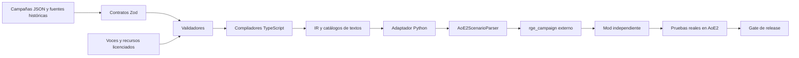

# Arquitectura

## Responsabilidades

| Directorio | Propiedad |
|---|---|
| packages/core | `diagnostics.helper.ts`, `serialization.helper.ts`, `filesystem.helper.ts` |
| packages/schemas | `campaign.schema.ts`: contratos estrictos versionados |
| packages/localization | `localization.catalog.ts`, `glossary.validator.ts`: claves, marcadores, lock, exportación UTF-8 y glosario |
| packages/historical-validation | `history.validator.ts`: fuentes, afirmaciones y trazabilidad narrativa |
| packages/gameplay-state | Typed actions, persistent snapshots, delivery ledgers, predicate evaluation and reference state transitions |
| packages/gameplay-validation | `gameplay.validator.ts`: referencias, objetivos, economía finita, grafo y conectividad |
| packages/scenario-compiler | `scenario.compiler.ts`: IR de escenarios con IDs de textos y variables |
| packages/campaign-compiler | `campaign.compiler.ts`: integridad, narradores y composición de IR |
| packages/audio | `audio.pipeline.ts`: proveedores, grabaciones, WAV, cache y SRT |
| packages/assets | `assets.validator.ts`: hashes, procedencia, licencias y resolución PNG |
| packages/aoe2-adapter | `python-bridge.adapter.ts`, `native-template.adapter.ts`, `native-campaign.renderer.ts` |
| tools/cli | `chronicles.script.ts`, `audio-build.pipeline.ts`, `project.loader.ts`, `project-config.schema.ts`, `staging.validator.ts`, `project-validation.validator.ts`, `documentation.validator.ts`, `release.validator.ts` y helpers de candidato/exportación |
| tools/python | Instalación aislada, escenarios, contenedor y ZIP |
| campaigns | Especificaciones editables; una carpeta por campaña |
| docs/wiki | Evidencia histórica y diseño por campaña |

La entrada y el IR son formatos propios, identificados como tales. Nunca se presentan como JSON reconocido por AoE2. El adaptador falla ante capacidades no implementadas. Las plantillas nativas deben proceder de archivos reales y conservar su estructura, con tokens @cdf para claves y valores.

Los módulos son unidades de responsabilidad, no microservicios ni paquetes npm publicados. Las dependencias fluyen de compiladores a validadores y contratos; los validadores no invocan el juego. Los proveedores multimedia no forman parte del mod que juega el usuario.

El build no modifica campañas ni el lock. La asignación de IDs es un comando explícito revisable. Los artefactos incluyen hash de la fuente, locales utilizados y límites de exportación. La publicación externa de mods es un paso humano separado de la integración Git.

## Nombres de módulos

Los archivos TypeScript de producción usan `<responsabilidad>.<tipo>.ts`, con responsabilidad en ASCII kebab-case y un sufijo de tipo que refleje lo que contiene (`.schema.ts`, `.helper.ts`, `.validator.ts`, `.compiler.ts`, `.adapter.ts`, `.renderer.ts`, `.pipeline.ts`, `.script.ts`). Se mantiene cada módulo dentro del directorio de dominio actual. No hay `index.ts` ni barrels: las importaciones nombran el archivo concreto, sin resolución implícita desde la carpeta. Las pruebas conservan el sufijo `*.test.ts` o `*.spec.ts` establecido por el proyecto.
# Composed capability profile (reference only)

Scenarios retain their schema-version-1 source envelope. An optional `capabilityProfile` explicitly selects the `composed-world-ledger` profile schema v2. Its contracts live in `packages/schemas/scenario-capability.schema.ts`, structural checks in `packages/gameplay-validation/scenario-capability.validator.ts`, deterministic IR compilation in `packages/scenario-compiler/capability.compiler.ts`, and immutable reference transitions in `packages/gameplay-state/capability-state.reducer.ts`, and snapshot construction in `packages/gameplay-state/capability-snapshot.factory.ts`. Native rendering and Python export reject this profile as `capability-not-implemented` until native implementation and QA are delivered in i00003/S3. See ADR 0004; these references do not certify game behavior.

## Alternative fulfillment: opt-in reference v3

The accepted [ADR](alternative-fulfillment.md) is i00007/S1. Its S2 implementation was integrated through the official gate at `4ac57b8f52dcb31af59303cea990abae152f8aff`; GPT-6.1 independently approved that integrated hash, and the verdict metadata landed at `66468212c5b70b10dc4a7effce31507bf83d4906`. DelendAI's `proposal_review action=status` confirmed S2 done on 23 October 2026. The [independent report](../../tests/alternative-fulfillment/reference/independent-review.md) describes the source review and empirical evidence; its publication-pending wording records when it was written, before that formal approval.

A scenario still uses source envelope v1. Only an explicit `capabilityProfile.schemaVersion=3` selects `alternative-fulfillment.schema.ts`; legacy v2 contracts, fixtures and string IDs remain unchanged. The compiler emits explicit v3 capability IR rather than silently lowering it to v2. `sharedCapabilityProfile` is a reference reuse boundary: the v3 snapshot nests the unchanged v2 core and the immutable reducer delegates real shared transactions and spatial observations to existing helpers. It is never an export fallback.

`fulfillment-state.reducer.ts` owns joint selection/reservation, refundable pre-work escrow, irreversible commitment and recipe-qualified departure/work/output/reception. `fulfillment-snapshot.factory.ts`, `fulfillment-snapshot.schema.ts` and `fulfillment-core-snapshot.validator.ts` validate conservation and lifecycle on load. The host must rotate the input context when restoring or replacing a world; the supplied loader returns a fresh epoch. A reference epoch is not evidence of native UI or queue integration.

Reference limits: one plan, at most 8 services and 8 recipes per service, at most 4096 complete selections, distinct workers across services, original inputs, distinct work/reception zones with same-hub circle-overlap checks, one observed zone per actor/batch, and at most one leading optional-arrival predicate. Preview is free; reserve moves the entire affordable cost once; cancellation before commitment returns only that escrow. After commitment, recorded work enables only the selected output, with original living recipients at its own court. Final success requires fresh living presence for every selected service. Required loss defeats before simultaneous victory; completed work does not silently require its worker to return as an extra recipient.

The [reference fixture](../../tests/alternative-fulfillment/reference/README.md) exercises 27 affordability trials, 95 portfolio paths and 24 before-funding witnesses through artificial observations. Those counts are not game tests or maps. Both the native renderer and Python adapter still reject composed v3 as `capability-not-implemented`. Existing export round-trips establish the previous supported fixture only. i00007/S3 remains pending until i00003 native composition/template/input prerequisites and s00001 engine evidence are satisfied; neither historical authoring nor game balance is approved by S2.
